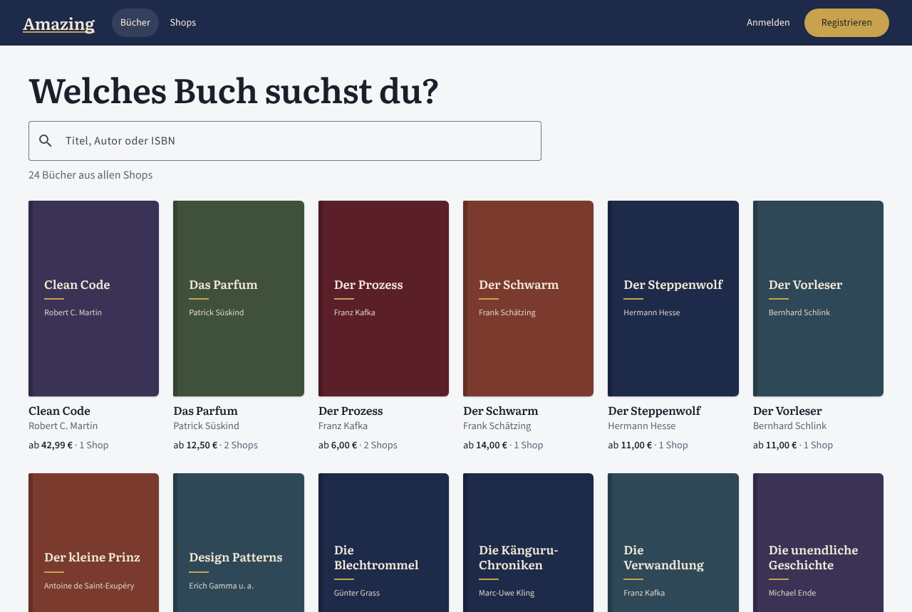

# „Amazing“ – Bücher-Marktplatz (Angular + NestJS + Prisma)

> Entstanden im **Programmierpraktikum (WiSe 2026/27) an der Universität Siegen**, Woche 4.
> Vollständige Webanwendung mit drei Rollen, JWT-Authentifizierung, PDF-Erzeugung und Spec-Driven Development.



Online-Marktplatz für Bücher mit drei Rollen: Kunden, Händler und Administratoren.
Entwickelt mit Spec-Driven Development: die Specs liegen in [`specs/`](specs/)
(`mission.md`, `tech-stack.md`, `roadmap.md` und eine Feature-Spec pro Phase).

## Starten

Voraussetzung: Node.js 20.19 oder neuer.

**Backend** (Terminal 1)

```bash
cd backend
cp .env.example .env              # Umgebungsvariablen anlegen
npm install
npx prisma migrate dev --name init   # legt die Datenbank an und füllt sie mit Testdaten
npm run start:dev                    # API auf http://localhost:3000/api
```

**Frontend** (Terminal 2)

```bash
cd frontend
npm install
npm start                            # App auf http://localhost:4200
```

Testdaten neu laden: `cd backend && npx prisma db seed`

## Demo-Zugänge

| Rolle | E-Mail | Passwort |
|-------|--------|----------|
| Administrator | admin@amazing.de | admin123 |
| Händler | haendler1@amazing.de | test123 |
| Händler | haendler2@amazing.de | test123 |
| Kunde | kunde1@amazing.de | test123 |
| Kunde | kunde2@amazing.de | test123 |

Die Zugänge lassen sich auf der Anmeldeseite auch direkt anklicken.

## Funktionen

**Kunden:** Bücher suchen (Titel, Autor, ISBN), Warenkorb, Bestellung mit Lieferadresse,
Rechnung als PDF, Bestellhistorie.

**Händler:** eigene Shops anlegen und bearbeiten, Bücher anbieten (aus dem Katalog oder neu),
Preis und Lagerbestand ändern, Bestellübersicht (offen / bearbeitet), Versandlabel als PDF,
Dashboard mit Umsatz pro Tag und pro Buch.

**Administratoren:** Übersicht über alle Händler sowie alle Kunden mit ihren Bestellungen.

Jede Rolle sieht nur ihre eigenen Funktionen. Das Backend prüft die Rolle bei jeder Anfrage
(401 ohne Anmeldung, 403 bei falscher Rolle), nicht nur die Oberfläche.

## Aufbau

```
backend/   NestJS 11, Prisma 6 (SQLite), JWT, pdfkit
frontend/  Angular 20, Angular Material
specs/     Spec-Driven Development (Constitution + Feature-Specs)
Screenshots/
```

Wichtige Entscheidung: Ein Warenkorb mit Büchern aus mehreren Shops wird beim Bestellen in
eine Bestellung pro Shop aufgeteilt. So bearbeitet jeder Händler nur seine eigenen Bestellungen.
