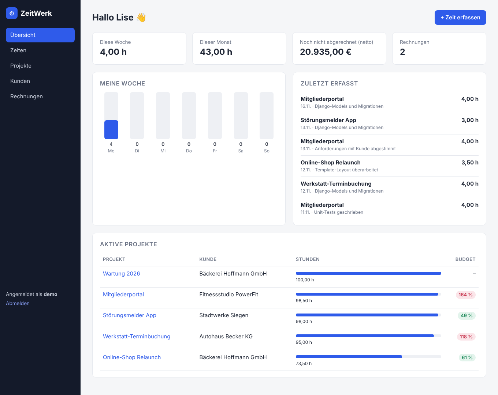
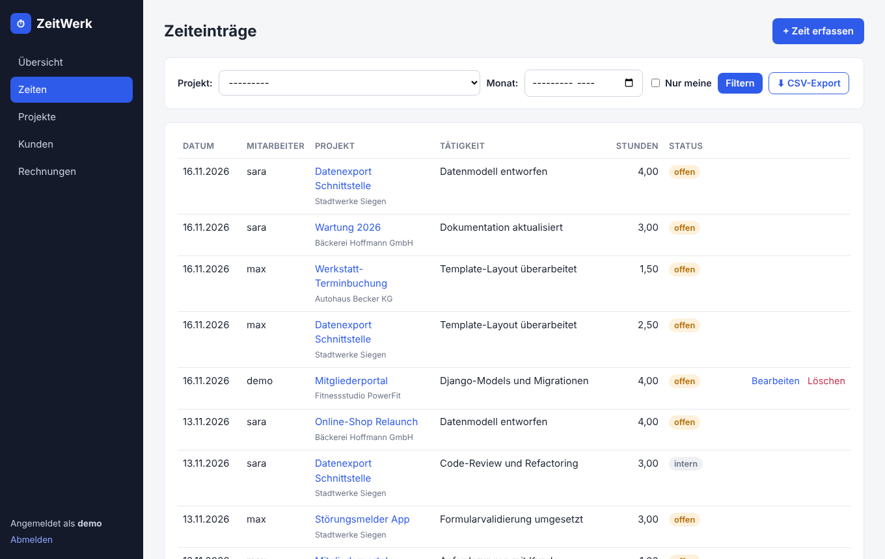
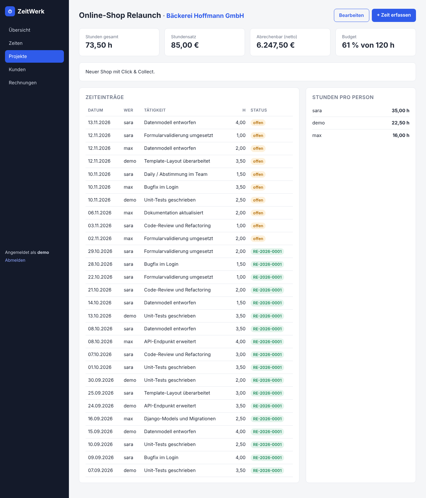
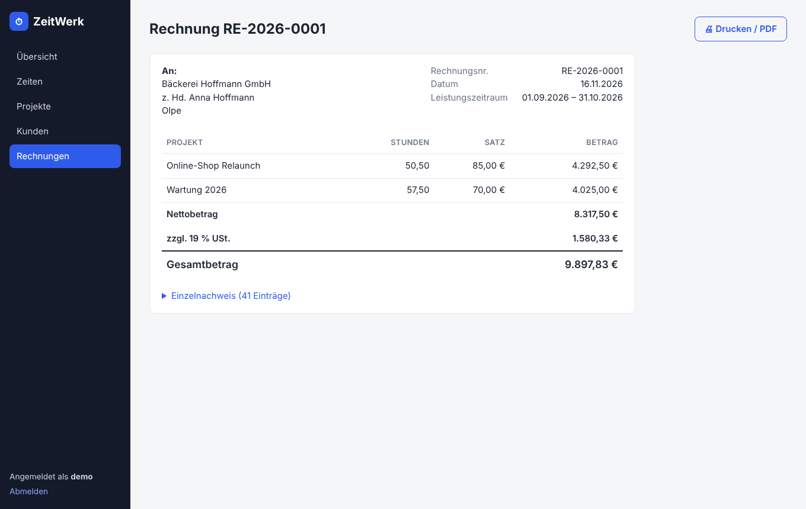
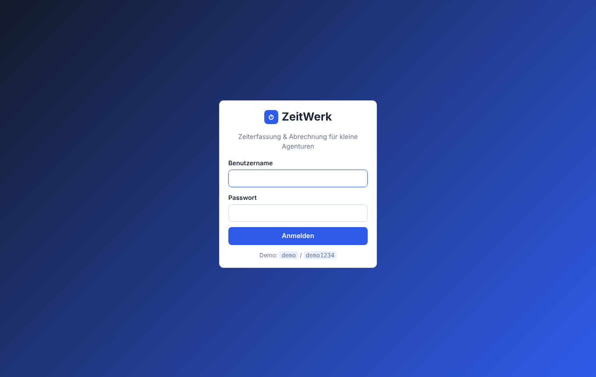

# ⏱ ZeitWerk – Zeiterfassung & Abrechnung mit Django

ZeitWerk ist eine kleine Webanwendung für Agenturen und Softwarefirmen: Mitarbeitende erfassen ihre
Arbeitszeit pro Projekt, Projektleiter sehen Budget und Umsatz, und aus den offenen Stunden wird
mit einem Klick eine Rechnung inkl. 19 % USt. erstellt.

Ich habe das Projekt gebaut, um mich mit **Python und Django** vertraut zu machen. Es verbindet meine
beiden Studienschwerpunkte der **Wirtschaftsinformatik**: saubere Softwareentwicklung und
betriebswirtschaftliche Prozesse (Leistungserfassung → Controlling → Fakturierung).



## Funktionen

| Bereich | Was es kann |
|---|---|
| **Login** | Django-Authentifizierung, alle Seiten nur für angemeldete Benutzer |
| **Zeiterfassung** | Zeiten in Viertelstunden erfassen, bearbeiten, löschen; Filter nach Projekt, Monat und „nur meine“ |
| **Projekte** | Stundensatz, Stundenbudget mit Ampel (ok / > 80 % / überschritten), Stunden pro Person |
| **Kunden** | Kundenverwaltung mit Projekten und Rechnungen |
| **Rechnungen** | Fortlaufende Rechnungsnummern (`RE-2026-0001`), Netto/USt./Brutto, Einzelnachweis, Druck/PDF über den Browser |
| **Export** | CSV-Export der gefilterten Zeiten (Excel-kompatibel, `;` und UTF-8-BOM) |
| **API** | JSON-Endpunkt `/api/projects/` mit Stunden und offenem Betrag pro Projekt |
| **Admin** | Django-Admin für alle Modelle |

### Geschäftsregeln (im Backend geprüft, nicht nur in der Oberfläche)

- Zeiten nur in Viertelstunden (0,25 – 12 h) und nicht in der Zukunft.
- Auf abgeschlossene Projekte kann nicht mehr gebucht werden.
- Jeder darf nur **eigene** Einträge ändern (sonst HTTP 403).
- Bereits **abgerechnete** Einträge sind gesperrt und können nicht doppelt abgerechnet werden.
- Rechnungserstellung läuft in einer **Datenbank-Transaktion**; Beträge werden mit `Decimal` kaufmännisch gerundet.

## Technik

- **Python 3.10+**, **Django 5.2 LTS**, SQLite
- Class-Based Views und Function-Based Views, ModelForms mit eigener Validierung
- ORM-Aggregationen (`Sum`, `Count`, `Coalesce`, gefilterte Aggregate) statt Schleifen in Python
- Geschäftslogik getrennt in `tracker/services.py`
- **16 automatisierte Tests** (Modelle, Rechnungslogik, Berechtigungen, CSV, API)
- GitHub Actions führt die Tests bei jedem Push aus
- Eigenes CSS ohne Framework, responsive

```
zeitwerk/
├── config/                 # Projekteinstellungen, URLs
├── tracker/
│   ├── models.py           # Customer, Project, TimeEntry, Invoice
│   ├── services.py         # Rechnungserstellung, Rechnungsnummern
│   ├── forms.py            # Validierung
│   ├── views.py            # Seiten, CSV-Export, JSON-API
│   ├── tests.py
│   └── management/commands/seed_demo.py
├── templates/
└── static/css/style.css
```

## Starten

```bash
python3 -m venv .venv
source .venv/bin/activate          # Windows: .venv\Scripts\activate
pip install -r requirements.txt
python manage.py migrate
python manage.py seed_demo         # Demo-Daten
python manage.py runserver
```

Dann <http://127.0.0.1:8000> öffnen und mit **demo / demo1234** anmelden
(weitere Benutzer: `max`, `sara`, gleiches Passwort). Der Admin liegt unter `/admin/`.

Tests ausführen:

```bash
python manage.py test
```

## Screenshots

| Zeiteinträge | Projekt |
|---|---|
|  |  |

| Rechnung | Login |
|---|---|
|  |  |

## Ideen für später

- Echte PDF-Rechnungen (z. B. WeasyPrint), REST-API mit Django REST Framework,
  Rollen (Mitarbeiter / Projektleitung), Timer-Funktion, Deployment mit Docker und PostgreSQL.

---
Lise Danielle Zambou · Wirtschaftsinformatik, Universität Siegen
